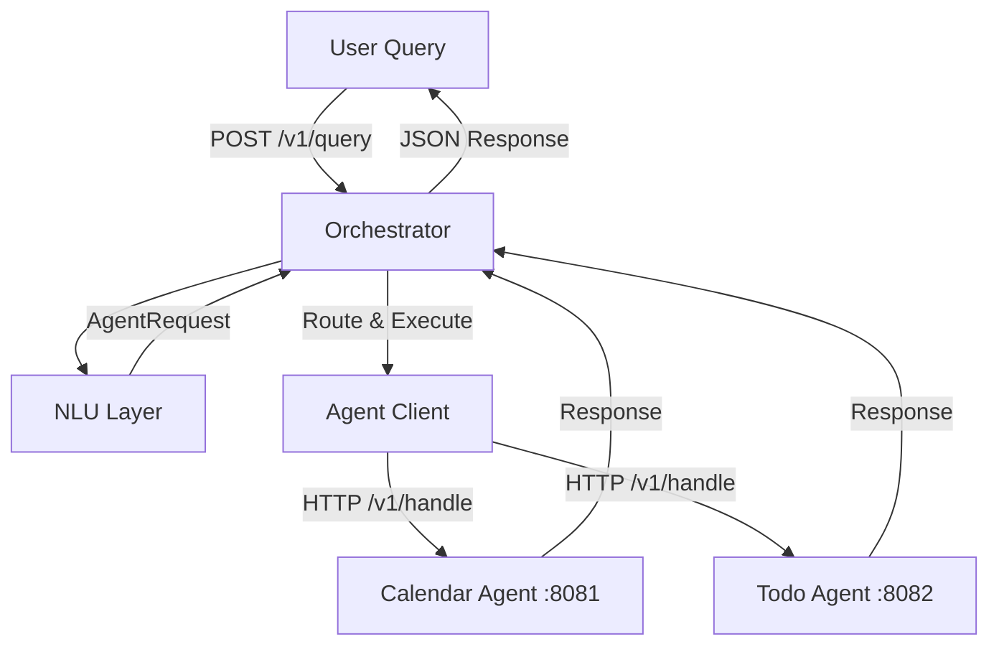

# DebussyOps Analysis & Documentation

### High-Level Architecture

```
User (Natural Language Query)
        ↓
   POST /v1/query
        ↓
   Orchestrator (cmd/orchestrator)
        ↓
   NLU Layer (internal/nlu) → KeywordNLU (or future LLM providers)
        ↓
   AgentRequest {ID, Agent, Action, Payload}
        ↓
   Orchestrator.RouteAndExecute()
        ↓
   Registered AgentClients (HTTP) → Example Agents (calendar/todo)
        ↓
   Response
```

**A provider-agnostic, extensible Master Orchestrator template in Go.**

DebussyOps is a clean, modular scaffold for building AI-powered orchestrators. It coordinates **modular sub-agents** using natural language input, with clear separation between NLU (Natural Language Understanding), orchestration logic, and agent execution.

Use it as a foundation for personal automation, business workflows, multi-agent systems, or production AI gateways.

## Features

- **Provider-agnostic NLU** — Plug in any intent parser or LLM (currently includes a simple keyword-based implementation)
- **Modular Agent System** — Register any number of agents (local or remote)
- **HTTP-based Agent Protocol** — Agents expose `/v1/handle` and `/v1/meta`
- **Dynamic Agent Registration**
- **Plugin Support** — Go plugin loader stub for dynamic `.so` modules
- **Structured Logging** — Powered by `zap`
- **Configuration** — Environment variables (easy to upgrade to Viper)
- **Docker & Docker Compose** ready
- **Extensible by Design** — Clean interfaces throughout

## Architecture



**Core Packages**:
- `cmd/orchestrator` — Application entrypoint
- `internal/nlu` — NLU interface + providers
- `internal/orchestrator` — Core coordination logic
- `internal/agent/client` — HTTP client for remote agents
- `internal/plugins` — Dynamic plugin loader
- `pkg/config` — Configuration management
- `examples/agents/*` — Reference agent implementations

## Quick Start

### Prerequisites
- Go 1.20+
- Make (optional but recommended)

### Local Development

```bash
# Clone the repo
git clone https://github.com/rcallaby/DebussyOps.git
cd DebussyOps

# Build everything
make build

# Run orchestrator + example agents
make run
```

The orchestrator will start on **http://localhost:8080**.

### Using Docker Compose (Recommended)

```bash
docker compose up --build
```

This starts:
- Orchestrator on `:8080`
- Calendar agent on `:8081`
- Todo agent on `:8082`

## Usage

### Query the Orchestrator

```bash
curl -X POST http://localhost:8080/v1/query \
  -H "Content-Type: application/json" \
  -d '{"input": "Schedule a meeting with the team tomorrow"}'
```

**Example Responses**:
- Calendar-related input → routes to `calendar` agent (`create_event`)
- Todo-related input → routes to `todo` agent (`add_task`)

### Health Check

```bash
curl http://localhost:8080/health
```

## Configuration

Set these environment variables:

| Variable       | Default                  | Description                  |
|----------------|--------------------------|------------------------------|
| `NLU_PROVIDER` | `keyword`                | NLU implementation to use    |
| `CALENDAR_URL` | `http://localhost:8081`  | Calendar agent endpoint      |
| `TODO_URL`     | `http://localhost:8082`  | Todo agent endpoint          |

Example:
```bash
NLU_PROVIDER=keyword CALENDAR_URL=http://localhost:8081 make run
```

> **Note**: The current config loader is minimal. Replace `pkg/config/config.go` with Viper for production use (as hinted in the code comments).

## Extending DebussyOps

### Adding a New NLU Provider

See `docs/Adding_NLU_Providers.md`

Implement the `nlu.NLU` interface:

```go
type NLU interface {
    Parse(input string) (*nlu.AgentRequest, error)
}
```

Then register it in `main.go`.

### Adding a New Agent

See `docs/Adding_Agents.md`

1. Create a new service that implements:
   - `POST /v1/handle`
   - `GET /v1/meta` (recommended)
2. Register it in the orchestrator:
   ```go
   myAgent := client.NewAgentClient("http://my-agent:8083", "")
   orch.RegisterAgent("my-agent", myAgent)
   ```

### Plugin System

The `internal/plugins` package supports loading Go plugins (`.so` files). It is currently not wired into the main orchestrator but ready for use.

## Project Structure

```
.
├── cmd/orchestrator/          # Main application
├── internal/
│   ├── agent/
│   │   └── client/            # HTTP agent client
│   ├── nlu/                   # NLU interface + providers
│   ├── orchestrator/          # Core orchestrator logic
│   └── plugins/               # Plugin loader
├── pkg/config/                # Configuration
├── examples/agents/           # Reference agent implementations
│   ├── calendar/
│   └── todo/
├── docs/                      # Extension guides
├── go.mod
├── Makefile
├── docker-compose.yml
├── Dockerfile
└── README.md
```

## Development

```bash
make fmt          # Format code
make test         # Run tests
make build        # Build binaries
```

## Roadmap / Future Improvements

- Integrate real LLM providers (OpenAI, Anthropic, Groq, Ollama, etc.)
- Add tool calling / function calling support
- Implement proper routing strategies (cost, latency, capability)
- Add authentication & rate limiting
- Wire in the plugin system
- Replace keyword NLU with semantic/LLM-based intent detection
- Add observability (metrics, tracing)
- Support streaming responses

## License

MIT License — see [LICENSE](LICENSE) file.

## Contributing

Contributions are welcome! Please see [CONTRIBUTING.md](CONTRIBUTING.md) and [CODE_OF_CONDUCT.md](CODE_OF_CONDUCT.md).


